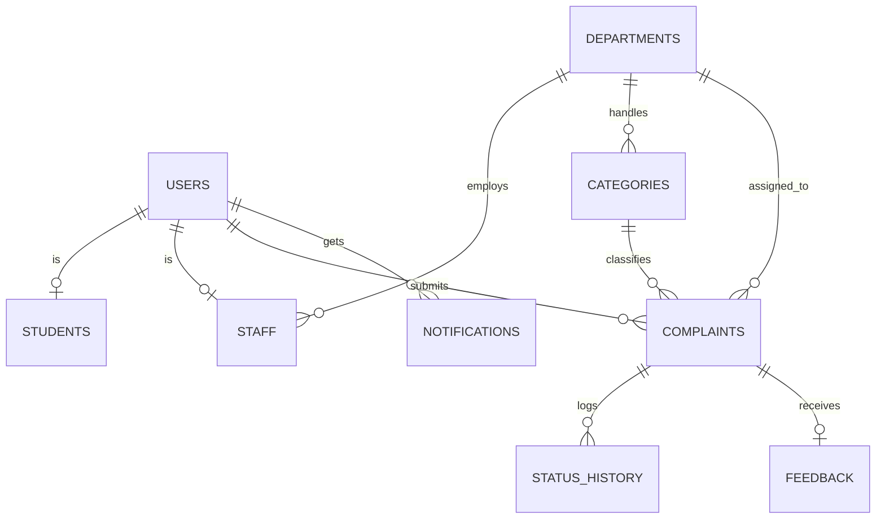

# College Complaint Portal – Online Campus Complaint Management System

Students submit complaints about campus facilities; department staff and administrators receive, route, track and resolve them.

## Run it (3 commands)
Requires **Node.js 22.5 or newer** (https://nodejs.org). No `npm install` is needed: the backend has zero dependencies.

```bash
cd backend
node server.js          # Windows/Mac/Linux
# open http://localhost:3000
```
The database (`backend/database/campus.db`) is created and seeded automatically on first start. Run `node test.js` in `backend/` for the 57 automated API tests.

## How a complaint moves
1. **Student** submits a complaint. It goes **only to the admin**. No department can see it yet.
2. **Admin** reviews it and assigns it to a department (the category suggests one, the admin decides).
3. **Department staff** see it only after assignment, are notified, and update the status (In Progress, Resolved or Rejected) with comments.
4. **Student and admin** are notified at every step.

## Logins
The home page has three separate logins: **Student login**, **Admin login** and **Department login** (choose the department, then sign in). An account only works on its own login page.

## Test accounts
| Login | Email | Password |
|---|---|---|
| Student | student@campus.edu | Student@123 |
| Admin | admin@campus.edu | Admin@123 |
| Dept: Hostel & Mess | hostel@campus.edu | Staff@123 |
| Dept: Academics | academics@campus.edu | Staff@123 |
| Dept: Infrastructure | staff@campus.edu | Staff@123 |
| Dept: IT & Network | it@campus.edu | Staff@123 |
| Dept: Library | library@campus.edu | Staff@123 |
| Dept: Administration | administration@campus.edu | Staff@123 |

If you ran an older version, delete `backend/database/campus.db` once so the new accounts are created.

## Folder structure
```
Campus-Complaint-System/
├── frontend/
│   ├── index.html        page shell
│   ├── style.css         responsive styles
│   ├── script.js         hash router + session restore
│   ├── components/ui.js  API client, navbar, toasts, complaint table
│   └── pages/            public, auth, student, staff, admin, complaint (details)
├── backend/
│   ├── server.js         HTTP server, static files, API dispatcher, security headers
│   ├── db.js             SQLite connection, schema load, seed data
│   ├── routes/index.js   route table with role rules
│   ├── controllers/      auth.js, complaints.js, admin.js (business logic)
│   ├── middleware/       auth.js (hashing, tokens), http.js (body parser, errors)
│   ├── database/schema.sql
│   ├── uploads/          evidence images
│   ├── test.js           automated API tests
│   └── package.json
└── README.md
```

## Architecture and why
- **Frontend:** plain HTML/CSS/JavaScript single-page app (hash routing). Easy to read and explain; no build step.
- **Backend:** Node.js REST API (`/api/...`) using only built-in modules, in a routes → middleware → controllers layering.
- **Database:** SQLite (built into Node 22) with foreign keys. Switchable to MySQL/PostgreSQL later by changing `db.js`.
- **Authentication:** signed HS256 tokens (8-hour expiry), sent as a Bearer header. The user's role is re-read from the database on every request.
- **File storage:** images saved in `backend/uploads/` under random names; served only to signed-in users.



## Security
scrypt password hashing with per-user salt · signed tokens · role-based access on every route · parameterised SQL only · input validation · image type checked by file signature and size-limited (2 MB) · login lockout after 5 failures · CSP and security headers · HTML escaping of all user content · CSV formula-injection guard · path-traversal protection.

## Features
Registration/login · three roles · complaint ID (CMP-YYYY-NNNN) · priority and due dates · admin review and assignment (category suggests a department) · admin reassignment · status updates with comments · Pending / In Progress / Resolved / Rejected · timeline history · anonymous option · image evidence · search and filters · dashboards · in-app notifications · feedback and ratings · user and category management · CSV report · automatic escalation of overdue complaints (checked every minute).

## Keeping data permanently
Everything (accounts, complaints, images) is stored in files. On a host with a temporary disk (such as Render's free plan) these files are erased whenever the service restarts or sleeps. To keep data, host it where the disk is permanent: set the environment variable `DATA_DIR` to the folder of a persistent disk (for example `/var/data`) and `JWT_SECRET` to any long random text. Running it on your own computer also keeps data.

## Known limitations
- Notifications are in-app only (no email sending).
- Anonymous complaints are hidden from staff and admins, but stored against the student account.
- Tokens live in browser localStorage; use HTTPS and a reverse proxy before any real deployment.
- No password-reset flow. Admins can create accounts but cannot yet edit a user's role.
- The SRS document and UML diagrams (use case, class, activity, sequence, architecture) are not included yet; only the ER diagram above.
